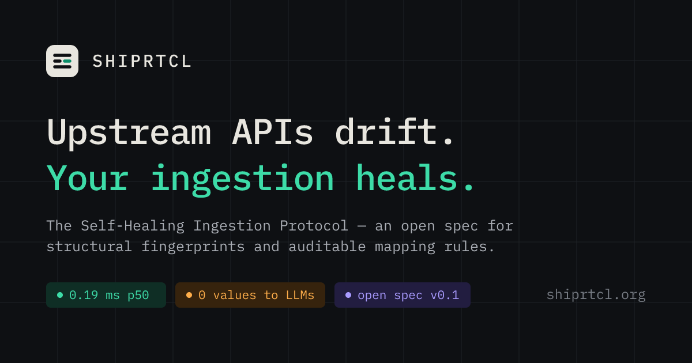

<p align="center">
  <a href="https://shiprtcl.org"></a>
</p>

<h1 align="center">SHIPRTCL — the Self-Healing Ingestion Protocol</h1>

<p align="center">
  <a href="https://shiprtcl.org/spec/">Spec v0.1</a> ·
  <a href="https://shiprtcl.org/whitepaper/">Whitepaper</a> ·
  <a href="https://shiprtcl.org/playground/">Playground</a> ·
  <a href="conformance/fingerprint-vectors.json">Conformance vectors</a>
</p>

<p align="center">
  
  
  
  <a href="https://www.npmjs.com/package/shiprtcl"></a>
  <a href="https://doi.org/10.5281/zenodo.23747811"></a>
  <a href="https://github.com/shiprtcl/shiprtcl/actions/workflows/ci.yml"></a>
</p>

---

Third-party webhooks and APIs change shape without asking you. Fields get renamed, nested, retyped, or switched from JSON to CSV, and your ingestion breaks in production.

**SHIPRTCL** is an open protocol for detecting that structural drift and repairing it at the point of ingestion, without hand-written adapters and without sending your data to a model.

```
payload ──► fingerprint ──► hit?  ──────────────► apply rule ──► validate ──► deliver (re-signed)
              (values           │                     ▲               │
              discarded)        └─► absorb / match ───┘               └─► hold for review / quarantine
                                     / model (optional, sees shapes only) / human
```

- **Structural fingerprint.** Every payload is normalized and reduced to a sorted set of `(JSON Pointer path, type)` pairs, then hashed. Values are discarded. Keys that are really data (ids, emails, dates) collapse into `MAP`. The result is `sr1:sha256:…`.
- **Rules are data, not code.** The SHIPRTCL Mapping Language has 8 operations (`to`, `from`, `const`, `default`, `enum`, `cast`, `scale`, `each`). It is total and terminates in linear time, so anything that proposes a rule — including an LLM — can be checked mechanically.
- **Hit → absorb → synthesize.** Known structures take the fast path. Added fields, omitted optionals and new `null`s are *absorbed* into existing rules, while renames are recognized as renames. Genuinely new structures get a rule synthesized **once**: deterministic matching first, an optional model second, a human whenever policy says so.
- **Fail closed, with receipts.** Output is validated against your contract on every request. Rules carry provenance and pass through `proposed → shadow → active → retired`. Every decision is a value-free CloudEvent.

The fast path costs **0.19 ms p50 / 0.58 ms p99** in plain TypeScript on one core (see `npm run bench`).

## What's in this repository

| Path | What |
|---|---|
| [`spec/shiprtcl-v0.1.md`](spec/shiprtcl-v0.1.md) | The normative specification (CC-BY-4.0) |
| [`whitepaper/shiprtcl-whitepaper.md`](whitepaper/shiprtcl-whitepaper.md) | Motivation, design, threat model, performance, **known limitations** |
| [`packages/shiprtcl`](packages/shiprtcl) | Reference implementation: engine, matcher, LLM adapter, proxy, CLI (Apache-2.0, zero runtime deps) |
| [`conformance/`](conformance) | Fingerprint test vectors any implementation must reproduce byte for byte |
| [`site/`](site), [`scripts/`](scripts) | Sources for [shiprtcl.org](https://shiprtcl.org) and the playground |

## Quick start

```bash
git clone https://github.com/shiprtcl/shiprtcl.git && cd shiprtcl
npm install
npm run all          # build → regenerate vectors → 37 tests → build site

# Fingerprint any payload
echo '{"event":"paid","customer":{"id":1}}' | node packages/shiprtcl/dist/cli.js fingerprint

# Run the reference proxy
cp examples/shiprtcl.config.json . && node packages/shiprtcl/dist/cli.js serve shiprtcl.config.json
```

As a library (`npm i shiprtcl`):

```ts
import { Engine } from 'shiprtcl';

const engine = new Engine({
  contracts: [{ id: 'payments.v1', schema: { type: 'object', required: ['event'], properties: { event: { type: 'string' } } } }],
});

const r = await engine.process('payments.v1', { body: rawBody, contentType: 'application/json' });
r.status;     // 'translated' | 'held' | 'quarantined'
r.resolution; // 'hit' | 'absorbed' | 'synthesized'
r.output;     // valid against your contract, or undefined
r.events;     // CloudEvents audit trail — never contains payload values
```

Add a model for structures the deterministic matcher can't resolve. Any OpenAI-compatible endpoint works:

```ts
import { Engine, chatCompletionsSynthesizer } from 'shiprtcl';

const engine = new Engine({
  contracts,
  synthesizer: chatCompletionsSynthesizer({ baseURL: 'http://localhost:11434/v1', model: 'llama3.1:8b' }),
  policy: { autoActivateSynthesized: false }, // model-assisted rules wait for review (default)
});
```

## Known limitations

SHIPRTCL repairs **structure**, not meaning. A switch from dollars to cents with no type change is invisible to it. A valid mapping can still be wrong when two fields share a type. The matcher's heuristics are English-centric. XML and YAML are specified but not yet in the reference implementation, and the reference proxy is single-node. The full list, with mitigations, is in [whitepaper §10](https://shiprtcl.org/whitepaper/#10-known-limitations).

## Contributing

The most valuable contributions right now:

1. **Real-world drift examples** for an open evaluation corpus (anonymized shapes only — see [CONTRIBUTING.md](CONTRIBUTING.md)).
2. **A second implementation** (Rust, Go, Python…) that passes the conformance vectors.
3. **Spec review.** Open an issue or a [SHIPRTCL Enhancement Proposal](spec/proposals/0000-template.md).

Please read [CONTRIBUTING.md](CONTRIBUTING.md), [GOVERNANCE.md](GOVERNANCE.md) and our [Code of Conduct](CODE_OF_CONDUCT.md). Report vulnerabilities privately per [SECURITY.md](SECURITY.md).

## Citing

See [CITATION.cff](CITATION.cff), or:

> Archik, S. (2026). *SHIPRTCL: Self-Healing Ingestion with Structural Fingerprints and Lazily Synthesized Mapping Rules* (v0.1.0, Draft). Zenodo. https://doi.org/10.5281/zenodo.23747812

## License

Code: [Apache License 2.0](LICENSE). Specification and whitepaper text: [CC BY 4.0](spec/LICENSE).
SHIPRTCL was created by Srishesh Archik in 2026.
